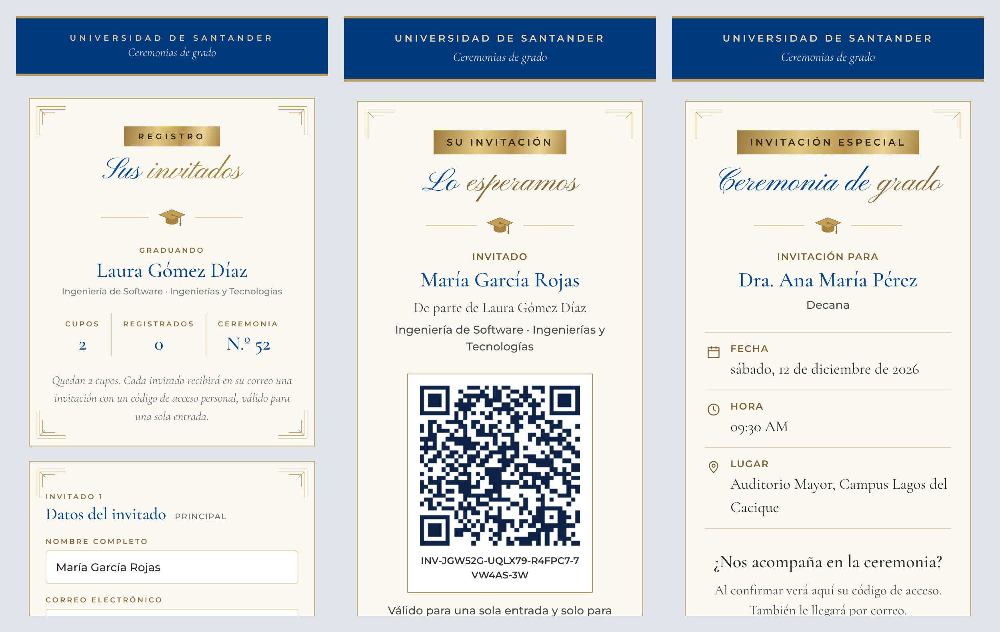
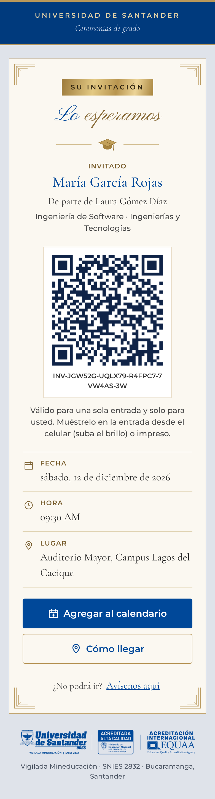
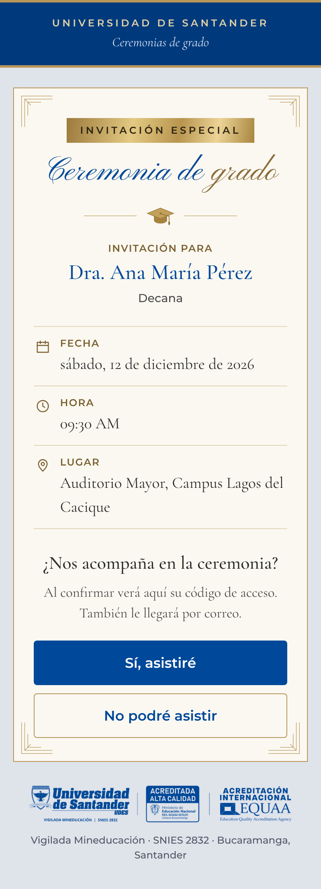
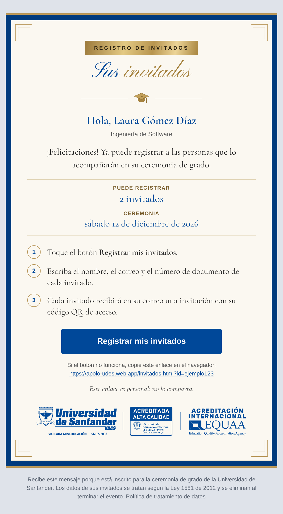
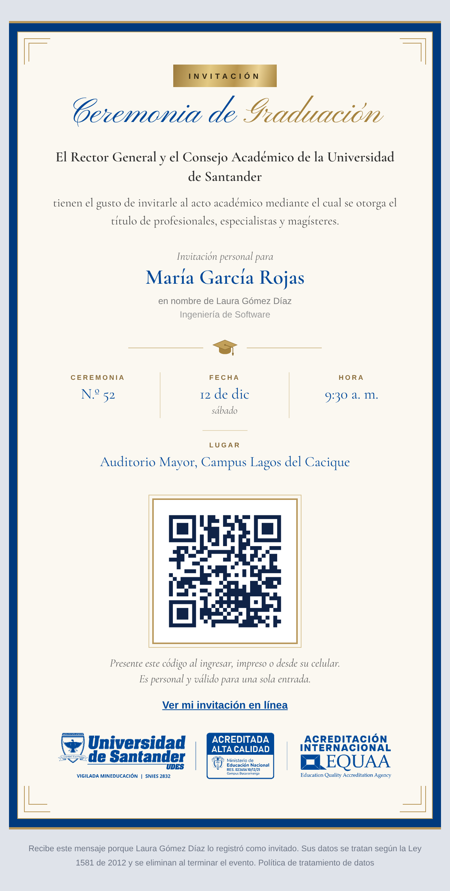

<p align="center">
  
</p>

<p align="center">
  
  
  
  <a href="https://apolo-udes.web.app"></a>
</p>

Sistema de control de acceso con código QR para las ceremonias de grado de la **Universidad de Santander (UDES)**, Bucaramanga.

Proyecto de grado de Ingeniería de Software · Henry Rodríguez Quintero.

---

## ¿Qué hace?

Cada graduando recibe un correo con un enlace personal para registrar a sus invitados. Cada invitado recibe su propia invitación con un código QR de un solo uso. El día de la ceremonia, los operadores escanean ese código en la entrada con una tablet y el sistema indica si la persona puede entrar.

- **App Flutter** (tablet Android y web) para administradores y operadores: graduandos, invitados, directivos, usuarios, bitácora y control de acceso.
- **Páginas web públicas** en Firebase Hosting: registro de invitados, “Mi invitación” y confirmación de directivos.
- **Cloud Firestore** con reglas que niegan todo salvo lo permitido explícitamente.
- **Google Apps Script** como servidor de correos: enlaces de registro e invitaciones con QR.

## 📸 Cómo se ve

Capturas con datos de ejemplo (no son personas reales).



| Registro de invitados | Mi invitación | Directivos |
|:---:|:---:|:---:|
|  |  |  |

| Correo de registro (graduando) | Invitación con QR (invitado) |
|:---:|:---:|
|  |  |

## 📁 Contenido del repositorio

| Carpeta | Qué tiene |
|---|---|
| [`apolo_udes/`](apolo_udes/) | App Flutter, páginas web públicas (`web/`) y `firestore.rules`. **Su [README](apolo_udes/README.md) es la documentación principal.** |
| `apolo_udes/test/` | Pruebas de unidad de los validadores |
| `apolo_udes/rules-tests/` | Pruebas de las reglas de Firestore contra el emulador |
| `apolo_udes/deploy/` | Guía de despliegue y limpieza de Firestore |
| [`apps-script/`](apps-script/) | Servidor de correos (Google Apps Script): plantillas, QR e imágenes de los correos |
| `admin-scripts/` | Scripts de Node para tareas de administración |

Las credenciales de servicio van en `claves/`, que **nunca** se sube al repositorio.

## Inicio rápido

```powershell
cd apolo_udes
flutter pub get
flutter run -d chrome
```

Publicar la app web y las páginas públicas:

```powershell
cd apolo_udes
flutter build web
firebase deploy --only hosting
```

Sitio publicado: <https://apolo-udes.web.app>

---

Universidad de Santander · Ingeniería de Software · 2026
